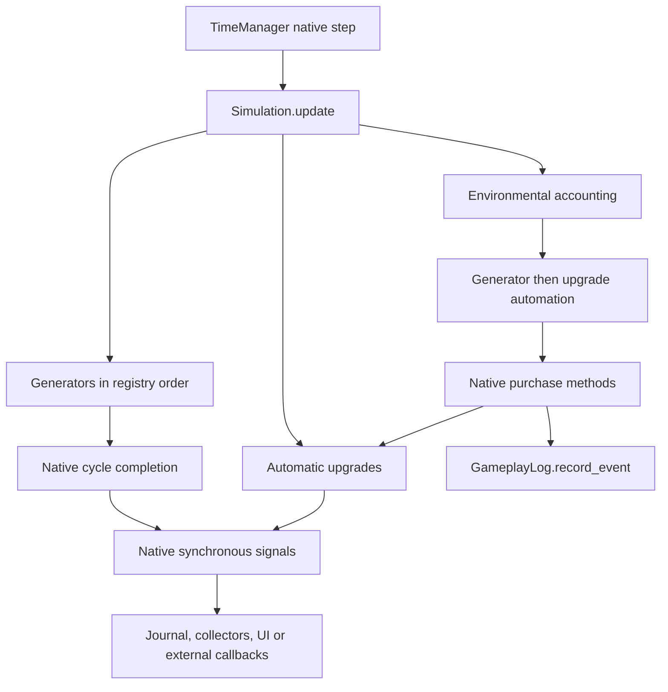
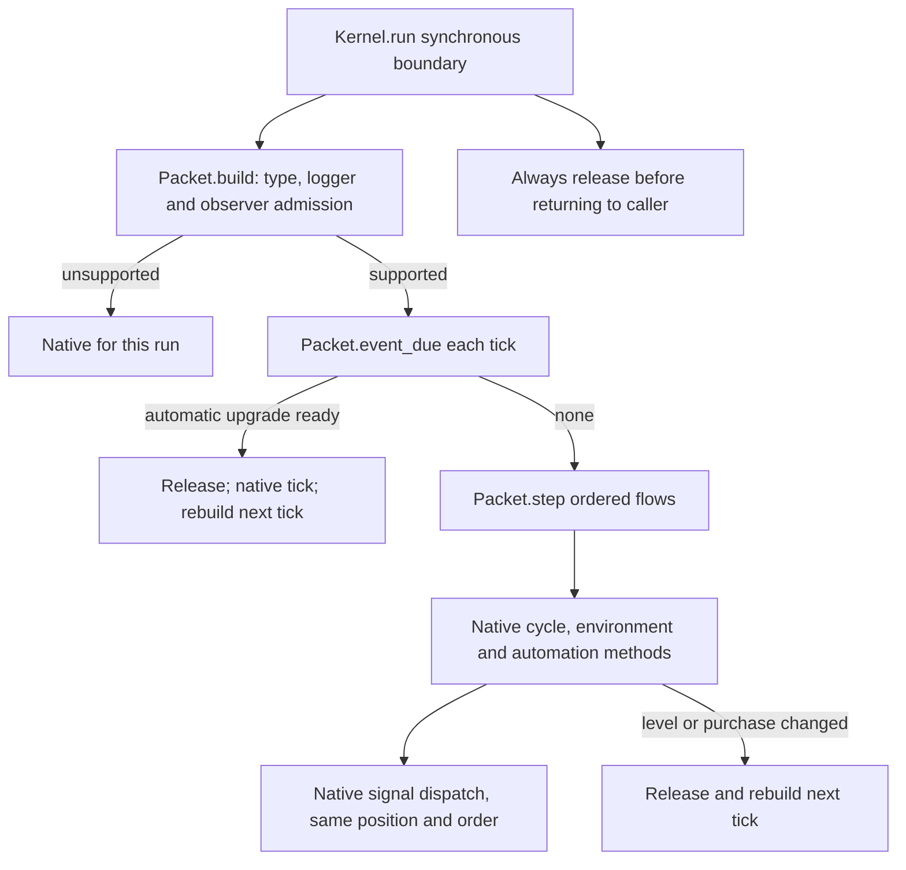

# Exact kernel observer audit and bounded compatibility

## Executive summary

Starting remote HEAD: `4aa3073602e150714baff4d312cc0e23d85b72d4` on
`feature/cycle-auto-run`. Intervening work since `eb5edae`: `8f5a067` added the
test-only TimeManager feasibility study; `4aa3073` added the production Options
logging toggle and fixed an existing indentation error. The local equivalent
logging commit was reconciled with remote HEAD without changing branches.
Initial working tree: no tracked modifications; one unrelated untracked file,
which is preserved.

**Verified:** observer connections are scanned at packet construction, not each
tick. Unsupported admission is latched only for the current synchronous public
run. No evidence supports a repeated per-tick observer scan or an existing
observer-triggered packet rebuild storm. Native signals still dispatch inside
the native cycle and upgrade implementations, at their original call sites.

The implementation adds independently switchable experimental counters and a
closed capability for one reviewed scalar-only receiver. Multiple instances may
coexist. The existing caller-owned journal remains supported. Arbitrary external
callbacks, production UI receivers, overridden scripts, connection flags,
bound/unbound callables and unproved dependencies remain native fallback.

This improves coverage of the measured read-only collector workloads. It does
**not** make the production client eligible. Measurements and limitations below
must accompany the coverage numbers. Production Simulation and TimeManager are
unchanged.

## Actual architecture and call graph





Source map (paths relative to repository root; function names are stable anchors):

| Location | Actual behavior |
|---|---|
| `simulation/simulation.gd:109`, `update` | Start-of-tick Heat; interval flags; automatic upgrades; generators; environment; generator then upgrade automation. |
| `simulation/simulation.gd:438`, `update_cycle_generator` | Native startup, progress, input limits, completion and auto-run, reused by packet. |
| `simulation/simulation.gd:649`, `complete_cycle` | Resolve critical events; completion resource writes/statistics; CF signal **before** Heat clearing; inventory reward before relic signal; consequences before cycle reset. |
| `simulation/simulation.gd:683,685,718,810,1322` | The five gameplay signal emission sites: critical/normal CF, relic reward, level reduction, generator unlock. |
| `simulation/simulation.gd:1012,1145,1483` | Native generator purchase, upgrade purchase and automatic upgrades. Purchase log entries are configuration-change witnesses. |
| `Resources/resource_state.gd`, `Generators/generator.gd`, `game_state.gd:set_resource_amount` | No resource-change or generator-state signal layer. Resource discovery and statistics are direct synchronous state writes. There is no hidden resource observer callback to batch. |
| `Game/GeneratorAutomationManager.gd:141`, `Game/UpgradeAutomationManager.gd:114` | Native cooldown/waiting rules and purchases; these managers declare no gameplay signals. |
| `tests/experimental/exact_flow_packet.gd:76`, `build` | Admission, then cached configuration/rates. Observer rejection is delegated at line 106. |
| `tests/experimental/exact_flow_observers.gd:rejection` | Full connection assessment once per packet; unknown connections return `external_observer`. |
| `tests/experimental/exact_flow_packet.gd:276,285` | `event_due` checks automatic-upgrade requirements, **not observer lists**. `step` retains native cycle signal dispatch. |
| `tests/experimental/exact_flow_kernel.gd:run` | One-shot packet lifecycle, failure latch, structural release, public-boundary release. No per-tick connection enumeration. |
| `tests/experimental/exact_flow_automation.gd:19,23` | Purchase invalidation uses owned TickLog length, not observer invocation counts. |
| `game.gd:157–174,1352–1415`, `RealmView/RealmView.gd:253–300` | Production crafting/VFX/toast receivers are connected before offline catch-up. UI unlock receiver is connected later. Toasts, controllers, nodes, tutorial queues and tweens are real dependencies. |
| `Game/time_manager.gd:126–212`, `game.gd:266–281` | Native offline clocks, dormancy, progress emission, frame yields and finalization; achievements are collected around catch-up by game wrapper. |
| `tests/experimental/offline_kernel_time_manager.gd:30,38,87` | Experimental adapter releases admission at progress/frame boundaries, partial steps and arbitrary on_tick debug callbacks; production coordinator remains inherited. |

Godot `Signal.connect`/`disconnect` owns registration and removal. There is no
authoritative application registration version to cache across arbitrary native
callbacks. Neither Simulation nor these receivers intercept registration.

## Classification and admission

| Receiver/dependency | Classification from code, not naming | Decision |
|---|---|---|
| Caller-supplied exact `transaction_events.gd` journal | Existing owned event append contract; retains scalar payload order | Retain previous support; caller must supply independently owned storage. |
| Exact `observer_readonly_sink.gd` | Primitive local counter/value writes only; no Object, Array, Dictionary or Callable fields; cannot hold/alias simulation state | Admit plain synchronous methods with exact signal/method identity. Multiple independent instances supported. |
| Extra mutable journal, even same script | Its event Array could alias inventory/configuration storage; script identity alone does not establish ownership | Reject. An explicit alias witness is tested. |
| `observer_fixture_callback.gd`, even action `observe` | Holds Simulation; configurable behavior; reads live state and can buy, change resources, automation, inventory or subscriptions | Reject all actions. Configurable action names are not safety proofs. |
| Production toast/VFX callbacks | Externally visible output; dynamic scene/controller/tween dependencies; not proved incapable of reentry or mutation | Reject; no rendering/presentation callback is omitted or postponed. |
| Generator unlock UI callback | Builds UI and queues tutorials; dependencies outside packet | Reject. |
| Automation managers | Required native gameplay mutations, cooldowns and purchase order | Keep native methods and current purchase invalidation. |
| Resource and generator state | No custom state notification signals in these native classes | Preserve direct writes; no speculative notification optimization. |
| Experimental adapter `on_tick` | Arbitrary external debug callable; can mutate configuration after a tick | Release before/after the callback; rebuild on reentry. Directed old/new/native witness retained. |
| Achievements, progress, loading/results | External coordinator/presentation boundaries | Retain native coordinator and release packet at yields; no production integration. |
| TickLog without clock | Existing audited in-memory record append, also used as purchase witness | Keep current support. |
| Production GameplayLog, including disabled | Disabled logger performs no file writes, but also has no TickLog purchase witness | Keep `external_logger_or_clock` rejection. Optional logging alone does not establish eligibility. |
| Deferred/one-shot/refcounted flags, bound/unbound callbacks, unknown scripts | Can change timing, registrations, dependencies or effects beyond proved contract | Native fallback. |

## Exact fallback and invalidation conditions

Observer-related rejection occurs **only** during `Packet.build` through
`Observers.rejection`: the object must be the exact owned journal or the exact
scalar collector, method must equal the signal name, flags must be zero and
bound/unbound argument counts zero. No invocation is replaced by a replay or an
instrumentation proxy. Native Godot connection order is unchanged.

Other admission failures remain independent: profiling/diagnostics/prestige,
unknown Simulation/GameState/cached/runtime scripts, external logger or clock,
unknown upgrade/requirement/effect contracts, statistics/resource scripts,
unsupported/nonfinite resources, generator/mode/IO/modifier/sensitivity scripts,
unsupported cycles/RNG/recipes/inventory/equipment semantics. Their existing
reason strings are retained. `build` is one-shot.

Inside admitted execution, automatic-upgrade readiness releases before writes
and executes that tick natively. Native cycle level changes and successful
automation purchases release after the tick. Resource balances, fractional
progress, completion rewards and read-only receiver invocations do not by
themselves rebuild rates. There is a single packet, not independently invalidated
per-generator packet shards. There was no observer invalidation mechanism to
make more selective.

Unknown callbacks can register/remove receivers or mutate any state while the
native fallback runs. The negative admission latch is intentionally conservative
until public reentry; it never permits stale positive eligibility. Reentry
constructs a new packet. A scalar receiver cannot register/remove anything, so
the accepted connection graph cannot change inside the synchronous run through
its callbacks. Frames, hot reload, concurrent mutation and external calls are
outside that exclusive interval; packets must not survive them.

## Instrumentation and methodology

`Kernel.observer_instrumentation` is independent of GameplayLog settings and
defaults off. Native receiver clocks additionally use `observer_instrument`,
also off by default. Benchmark-owned `metered_observers` only supplies local
diagnostic totals; it never confers admission. Counters are aggregated in memory
and exported after a scenario, never printed per tick.

Metrics distinguish eligible/native ticks, per-build rejection counts from
fallback **tick** counts by reason, connection and signal checks, invocations,
callback time, observer/automation/cycle/automatic-upgrade invalidations,
construction attempts, rebuild attempts after the first construction, admission
and construction time. Observer invalidations stay zero because mutating
callbacks are not admitted. A callback-triggered mutation in fallback is **not**
misreported as a packet invalidation: no live packet exists in that path.

`eligibility_usec` and `packet_build_usec` intentionally cover the **same total
admission-plus-construction interval**, because existing validation and rate
compilation are interleaved. They are overlapping measurements and must never be
summed. `observer_check_usec` isolates the observer admission scan inside that
interval. Callback timers include receiver-body work and intrusive clock cost;
use instrumentation-off throughput for speedup claims. These counters describe
the latest instrumented public run; existing kernel counters remain cumulative. They cover Simulation
signal receivers, not arbitrary frame/UI callbacks. Offline progress boundaries
are counted separately by the inherited coordinator adapter.

The frozen `baselines/exact_flow_4aa3073_{kernel,packet}.gd` preserves the previous
dispatcher/packet implementation, including its old observer predicate. Both
versions use identical current native Simulation, fixture and collector code;
diagnostics are off for baseline and optimized throughput. This isolates the
packet/dispatcher change, rather than attributing altered fixture setup to an
optimization. All setup, snapshot parsing and validation are outside timing.

Core/consumer/mid/Forge/crafting/equipment/feedback cases reuse saved earned
progression from existing fixture builders. `forge_together` and its forced
completion edge are explicitly **diagnostic** mutation witnesses, not claims of
reachable earned progression. Scalar collectors approximate read-only observers,
not the actual production renderer. `observe` reads balances, generator level
and RNG at the exact callback boundary; unknown/mutating receivers stay native.

Each synchronous scenario uses one warmup and five measured paired repeats,
reversing method order on alternate repeats. Four methods: authoritative native,
frozen previous kernel, optimized kernel, and optimized with instrumentation.
Report medians, min/max variation, paired ratios and instrumentation cost, not
the fastest run. No performance run overlaps a regression process.

The offline scenario uses the existing experimental TimeManager adapter with
the **unchanged native** coordinator, a fixed timestamp, earned repeated-crafting
state and one hour elapsed. It retains clocks, dormancy, partial final step,
100-step yield schedule and finalization. One warmup plus three measured repeats;
throughput uses actual processed steps, including floating-point remainder.
It excludes scene startup, renderer and save-file IO, so is not client loading
speed. The disabled real logger probe is a correctness/admission diagnostic,
not a zero-duration performance sample.

All timing fixtures use the same in-memory TickLog without an external clock.
No production log file is enabled to inflate native cost. The Options toggle is
applied before offline catch-up in production; it is neither a kernel switch nor
a benchmark instrument switch.

## Confirmed callback safety gap

`offline_kernel_time_manager.gd:87` previously invoked its arbitrary `on_tick`
debug/validation callable while retaining the packet. That callable receives the
adapter and can make a native purchase between ticks. A directed 1.2-second
coordinator test proves stale cached production: the archived adapter diverges
from native after the callback buys an Atomic Friction level. The corrected
adapter matches native exactly.

The corrected hook releases the packet both before and after invocation and
clears its negative latch for fresh admission. Callback timing/count and clock
position are unchanged. The witness has 13 actual steps (including the floating
remainder), exactly 13 callback invocations, 12 accelerated full steps and one
native partial step. The corrected adapter records 12 observer packet releases
and 12 builds; the archived unsafe adapter built once. This additional rebuild
cost is required for arbitrary callbacks, not reported as an optimization.

Evidence: `observer_callback_boundary_validation.json` requires both
`legacy_diverged: true` and `native_corrected_exact: true`. Existing offline smoke
and critical/combined/starved boundary pairs pass exact graph/clock/save/results
and trace comparisons after the repair. No production TimeManager code changes.
All timed offline workloads leave `on_tick` unset, so this repaired branch does
not execute in the throughput datasets.

## Optimizations implemented

1. Extracted observer admission into a closed experimental capability check.
   The supplied owned journal retains its existing contract; the exact primitive
   collector can now run without disabling cached ordered flows. Godot still
   executes every connected method synchronously at the original native site.
2. Kept eligibility scoped to one exclusive synchronous packet lifetime. No
   per-tick observer scan, registration interception or second invalidation
   system was added. Unknown configurations retain their existing native latch.
3. Fenced the experimental on_tick hook as an external mutation boundary.
   Native callbacks still run once at their original point; no cached packet
   survives arbitrary hook execution.
4. Added switchable diagnostics and metered receivers, extending the existing
   explicit checkpoint descriptor for the journal's three diagnostic fields.
   Rollback captures/restores those fields; existing alias and schema checks
   remain enabled. Automation event names are classified from the existing
   owned log witness, without adding a gameplay mutation API. Cycle and purchase
   causes can co-occur and are recorded independently.

## Deliberately rejected changes

- No per-tick observer scan removal: the supposed scan does not exist.
- No cross-run positive eligibility cache: native registration, direct script
  changes and arbitrary callbacks have no complete tracked mutation boundary.
- No trust-by-name, configurable read-only flag or public registration API.
- No blanket admission of extra mutable journals; array ownership is unproved.
- No swallowing callback errors, skipped callbacks, batching, deferred replay,
  reordered emissions, or modified authoritative Simulation.
- No targeted observer packet shards: unknown callbacks can mutate everything;
  supported callbacks already cause zero observer invalidations.
- No disabled-logger shortcut while automation still uses log append counts as
  purchase witnesses. Decoupling that witness deserves its own reviewed work.
- No production TimeManager integration or claim that headless scalar receiver
  compatibility establishes rendered-client safety.

## Validation and results

The complete regression runner passed **99 groups, zero failures** (all 98
previous groups retained plus the observer group). The separate full crafting
runner passed **35 cases / 60,000 dense tick endpoints** against native and its
existing archive, including native critical outcomes, both RNG streams and
follow-on sequence checks. The focused observer runner passed **52 cases /
8,620 dense endpoints**, plus public reentry, save/load, flag/alias rejection,
instrumentation equivalence and an awaited deferred-completion comparison.

The focused matrix covers no receivers, owned journal, multiple scalar receivers,
state-reading unknown receivers, multiple external receivers with a shared
ordering trace, resource writes, native generator purchases, enabled automation
changes, random inventory rewards, connect/disconnect/replace during a callback,
and recovery at the next public boundary. Both Forge and Crucible completion
witnesses actually execute. The generator-purchase witness must succeed; the
alias witness must be refused. Earned first/repeated crafts and consumer states
also receive longer dense comparisons.

Equality is byte-exact, using the existing detailed tick view (all resources,
statistics, discovery, levels/modes/phases, integer/fractional output, upgrades,
equipment/inventory, automation caches/cooldowns, log/events and both RNG streams)
and additional ordered callback observations. Existing complete-graph and alias
checks remain in the retained suites. No numerical tolerances were widened.
Diagnostic clocks are intentionally outside gameplay equality. Callback counts
are checked against actual receiver histories/counters. No error-catching or
warning-suppression layer was added. Intentional runtime-error emission is not
part of the passing suite; unsupported callables retain native execution.

The successful regression, crafting, focused, editor-import and offline boundary logs contain no parser/runtime
errors or warnings. Evidence: `observer_regression.log`,
`observer_crafting_regression.log`, `observer_crafting_validation.json`,
`observer_tests.log`, and `observer_validation.json`.

## Baseline instrumentation and confirmed bottlenecks

- The frozen kernel rejects the additional read-only receivers once per public
  run with `external_observer`, then spends every tick in native fallback. It
  still invokes all receivers. In the ordinary 2,000-tick read-only cases it
  builds once and falls back 2,000 times. Rejection counts and fallback tick
  counts are distinct.
- The optimized ordinary read-only case checks 15 connections once, admits all
  2,000 ticks and builds once. The mid-game case has 45 connection checks over
  three builds, two native automatic-upgrade ticks and 99.9% coverage. Those
  rebuilds are structural/upgrade work, not observer mutations.
- The eight-extra-receiver diagnostic checks 90 connections over two builds,
  invokes 18 callbacks, and has one automatic-upgrade fallback tick (99.95%
  coverage). Median observer scan time is 412 µs total (317–535); median callback
  body time is 8 µs (6–12). Observer invalidations remain zero.
- Thus the verified performance restriction is **whole-run fallback eligibility**,
  not a repeated observer scan in the hot loop. General simulation, native
  crafting and existing structural events account for the remaining work.
- The separate arbitrary adapter hook really did have an untracked mutation
  boundary. It is repaired conservatively, with a reproducible legacy divergence.

Times below come from all measured repeats. Count fields are deterministic;
observer scan/callback/construction timing fields in the summary are medians,
with min/max in `observer_time_ranges`. Explicitly registered/enabled meters
cover every fixture receiver, including receivers added inside callbacks. For
other callers, unsupplied/disabled meters mean unmeasured callback cost, not
proof of zero callback activity. Observer timers are collected on the optimized
instrumented method; frozen baseline throughput and its existing build/fallback
counters remain untouched.

## Before/after performance

Environment: Linux, Intel Xeon Platinum 8573C, nine visible logical processors,
Godot 4.6.1 official `14d19694e`, debug-capable build, native step 0.1 seconds.
The 29 synchronous scenarios, original offline control, matched-dispatch offline
confirmation and disabled-logger diagnostic produced **748 retained result rows**
and **565 non-native exact comparisons**, all passing. Warmups are included in
the retained rows and excluded from reported medians.

The synchronous matrix has five measured repeats per method after one warmup.
Each offline dataset has three measured repeats after warmup. The matched
confirmation process stopped after complete repeats 0 and 1; those samples were
retained, and only repeats 2 and 3 were resumed on the same verified engine/CPU.
A new-process warmup is retained as repeat -1. No incomplete result, outlier or
slow sample was selected into or removed from the medians.

The table gives both ratio of median elapsed times and the median/range of
per-repeat paired ratios. They can differ substantially under uneven shared-host
pauses. In particular, a paired median must not hide a slower ratio of displayed
median throughputs. Negative apparent instrumentation cost is noise, not a claim
that enabling clocks speeds up the simulation.

| State / observers / ticks | Native ticks/s (median; range) | Kernel ticks/s (median; range) | Median-time speedup | Paired speedup (median; range) | vs previous median times | Coverage before → after | Instrumentation cost |
|---|---:|---:|---:|---:|---:|---:|---:|
| early / journal / 2,000 | 4,298; 3,813–4,474 | 9,509; 8,612–10,190 | 2.212× | 2.259×; 2.139–2.371 | 1.035× | 100.000% → 100.000% | +4.1%; -7.5–+17.5% |
| early / readonly / 2,000 | 4,549; 3,943–4,721 | 8,744; 7,411–9,782 | 1.922× | 1.922×; 1.760–2.252 | 1.839× | 0.000% → 100.000% | +2.9%; -11.9–+12.5% |
| consumer_50000 / journal / 2,000 | 3,056; 1,573–3,226 | 4,124; 3,940–5,447 | 1.349× | 1.688×; 1.343–2.505 | 0.785× | 100.000% → 100.000% | -0.7%; -21.6–+6.3% |
| consumer_50000 / readonly / 2,000 | 3,339; 2,827–3,613 | 4,584; 2,827–5,704 | 1.373× | 1.373×; 1.000–1.579 | 1.437× | 0.000% → 100.000% | -0.1%; -28.7–+25.7% |
| mid / journal / 2,000 | 4,365; 3,960–4,547 | 6,170; 5,812–6,464 | 1.413× | 1.481×; 1.278–1.558 | 1.027× | 99.900% → 99.900% | +8.2%; -2.7–+12.6% |
| mid / readonly / 2,000 | 4,401; 3,977–4,442 | 6,039; 5,482–6,387 | 1.372× | 1.359×; 1.272–1.532 | 1.477× | 0.000% → 99.900% | -2.0%; -6.6–+29.1% |
| forge_competing / journal / 2,000 | 1,442; 1,346–1,493 | 1,963; 1,851–2,082 | 1.361× | 1.365×; 1.284–1.495 | 0.990× | 100.000% → 100.000% | -0.7%; -7.1–+4.5% |
| forge_competing / readonly / 2,000 | 1,471; 1,445–1,523 | 1,976; 1,413–2,049 | 1.344× | 1.297×; 0.961–1.408 | 1.331× | 0.000% → 100.000% | -4.1%; -28.1–+2.2% |
| earned_craft_first_craft / journal / 2,000 | 2,346; 2,327–2,492 | 2,874; 2,649–3,009 | 1.225× | 1.185×; 1.129–1.293 | 0.975× | 100.000% → 100.000% | -0.2%; -9.5–+8.4% |
| earned_craft_first_craft / readonly / 2,000 | 2,286; 1,520–2,494 | 2,158; 1,737–3,075 | 0.944× | 1.266×; 0.696–1.370 | 1.146× | 0.000% → 100.000% | -3.1%; -28.4–+12.8% |
| earned_craft_repeat_craft / journal / 2,000 | 2,393; 2,354–2,489 | 2,960; 2,737–3,088 | 1.237× | 1.239×; 1.133–1.312 | 0.978× | 100.000% → 100.000% | +3.3%; -8.7–+12.0% |
| earned_craft_repeat_craft / readonly / 2,000 | 2,355; 1,453–2,418 | 3,036; 2,354–3,096 | 1.289× | 1.286×; 1.233–1.620 | 1.282× | 0.000% → 100.000% | +0.0%; -12.3–+5.0% |
| reached_multiple / journal / 2,000 | 2,381; 1,952–2,401 | 2,911; 2,701–3,222 | 1.223× | 1.342×; 1.134–1.491 | 0.965× | 100.000% → 100.000% | -5.1%; -10.4–+5.6% |
| reached_multiple / readonly / 2,000 | 2,366; 2,317–2,389 | 3,077; 2,873–3,190 | 1.300× | 1.288×; 1.214–1.372 | 1.320× | 0.000% → 100.000% | +6.9%; -7.8–+7.6% |
| earned_feedback / journal / 2,000 | 1,846; 1,701–1,863 | 2,694; 2,608–2,710 | 1.460× | 1.460×; 1.403–1.563 | 1.037× | 100.000% → 100.000% | +8.5%; -4.8–+25.2% |
| earned_feedback / readonly / 2,000 | 2,087; 2,042–2,119 | 2,958; 2,910–3,065 | 1.417× | 1.439×; 1.386–1.469 | 1.442× | 0.000% → 100.000% | +2.9%; +0.7–+7.3% |
| early / none / 2,000 | 5,435; 4,306–5,816 | 10,747; 9,705–11,317 | 1.977× | 1.969×; 1.848–2.254 | 1.011× | 100.000% → 100.000% | -0.6%; -4.6–+3.3% |
| early / journal / 36,000 | 5,268; 5,139–5,305 | 9,233; 8,436–9,832 | 1.753× | 1.774×; 1.641–1.866 | 0.980× | 100.000% → 100.000% | +2.0%; -5.2–+3.9% |
| early / none / 36,000 | 5,227; 4,203–5,358 | 9,701; 9,511–9,834 | 1.856× | 1.841×; 1.792–2.308 | 1.009× | 100.000% → 100.000% | -0.6%; -1.1–+2.5% |
| forge_together / heavy / 2,000 | 3,231; 3,142–3,308 | 5,131; 4,927–5,498 | 1.588× | 1.588×; 1.525–1.750 | 1.585× | 0.000% → 99.950% | +2.8%; -11.4–+4.7% |
| forge_together / observe / 1,000 | 3,133; 3,081–3,190 | 3,029; 2,915–3,075 | 0.967× | 0.964×; 0.920–0.982 | 0.983× | 0.000% → 0.000% | -2.1%; -4.6–+4.4% |
| forge_together / resource / 1,000 | 2,981; 2,757–3,060 | 2,501; 2,365–3,048 | 0.839× | 0.831×; 0.787–1.059 | 0.865× | 0.000% → 0.000% | -9.6%; -21.4–+92.0% |
| forge_together / upgrade / 1,000 | 1,810; 79–2,779 | 1,315; 381–2,706 | 0.726× | 0.955×; 0.726–16.133 | 0.603× | 0.000% → 0.000% | -12.3%; -55.2–+112.3% |
| forge_together / automation / 1,000 | 2,570; 2,481–2,747 | 2,546; 2,346–2,646 | 0.991× | 0.964×; 0.920–1.026 | 1.000× | 0.000% → 0.000% | +1.0%; -9.5–+50.9% |
| forge_together / inventory / 1,000 | 2,374; 1,342–2,697 | 2,346; 323–2,719 | 0.989× | 1.008×; 0.132–1.399 | 2.142× | 0.000% → 0.000% | -8.2%; -80.8–+30.4% |
| forge_together / register / 1,000 | 2,500; 1,750–2,650 | 2,407; 1,914–2,520 | 0.963× | 0.969×; 0.772–1.370 | 0.907× | 0.000% → 0.000% | -5.7%; -28.9–-0.4% |
| forge_together / remove / 1,000 | 2,740; 2,493–2,784 | 2,560; 2,492–2,763 | 0.934× | 0.951×; 0.913–1.016 | 0.955× | 0.000% → 0.000% | -0.2%; -6.0–+20.7% |
| forge_together / replace / 1,000 | 2,622; 2,530–2,660 | 2,412; 2,297–2,662 | 0.920× | 0.931×; 0.895–1.008 | 0.924× | 0.000% → 0.000% | -5.5%; -7.1–+3.8% |
| forge_together / mixed / 1,000 | 2,630; 2,544–2,726 | 2,588; 2,190–2,672 | 0.984× | 0.977×; 0.833–1.036 | 0.998× | 0.000% → 0.000% | -0.8%; -16.7–+17.5% |
| offline_one_hour / readonly / 36,001 | 1,957; 1,886–2,113 | 3,424; 2,685–3,584 | 1.750× | 1.620×; 1.423–1.831 | 1.201× | 0.000% → 99.997% | — |
| offline_matched_dispatch / readonly / 36,001 | 2,168; 1,679–2,374 | 2,522; 2,516–2,762 | 1.163× | 1.163×; 1.060–1.645 | 1.105× | 0.000% → 99.997% | — |

| State / observers / ticks | Observer checks / signals | Check µs | Calls / callback µs | Builds / rebuilds | Cycle / automation / automatic-upgrade invalidations | Fallback ticks by reason |
|---|---:|---:|---:|---:|---:|---|
| early / journal / 2,000 | 5 / 7 | 83.0 | 0 / 0.0 | 1 / 0 | 0 / 0 / 0 | {} |
| early / readonly / 2,000 | 15 / 7 | 121.0 | 0 / 0.0 | 1 / 0 | 0 / 0 / 0 | {} |
| consumer_50000 / journal / 2,000 | 5 / 7 | 100.0 | 0 / 0.0 | 1 / 0 | 0 / 0 / 0 | {} |
| consumer_50000 / readonly / 2,000 | 15 / 7 | 125.0 | 0 / 0.0 | 1 / 0 | 0 / 0 / 0 | {} |
| mid / journal / 2,000 | 15 / 21 | 270.0 | 1 / 2.0 | 3 / 2 | 0 / 0 / 2 | {"automatic_upgrade": 2.0} |
| mid / readonly / 2,000 | 45 / 21 | 344.0 | 3 / 3.0 | 3 / 2 | 0 / 0 / 2 | {"automatic_upgrade": 2.0} |
| forge_competing / journal / 2,000 | 5 / 7 | 79.0 | 0 / 0.0 | 1 / 0 | 0 / 0 / 0 | {} |
| forge_competing / readonly / 2,000 | 15 / 7 | 115.0 | 0 / 0.0 | 1 / 0 | 0 / 0 / 0 | {} |
| earned_craft_first_craft / journal / 2,000 | 5 / 7 | 70.0 | 1 / 2.0 | 1 / 0 | 0 / 0 / 0 | {} |
| earned_craft_first_craft / readonly / 2,000 | 15 / 7 | 146.0 | 3 / 4.0 | 1 / 0 | 0 / 0 / 0 | {} |
| earned_craft_repeat_craft / journal / 2,000 | 5 / 7 | 76.0 | 1 / 2.0 | 1 / 0 | 0 / 0 / 0 | {} |
| earned_craft_repeat_craft / readonly / 2,000 | 15 / 7 | 101.0 | 3 / 5.0 | 1 / 0 | 0 / 0 / 0 | {} |
| reached_multiple / journal / 2,000 | 5 / 7 | 67.0 | 0 / 0.0 | 1 / 0 | 0 / 0 / 0 | {} |
| reached_multiple / readonly / 2,000 | 15 / 7 | 90.0 | 0 / 0.0 | 1 / 0 | 0 / 0 / 0 | {} |
| earned_feedback / journal / 2,000 | 5 / 7 | 69.0 | 0 / 0.0 | 1 / 0 | 0 / 0 / 0 | {} |
| earned_feedback / readonly / 2,000 | 15 / 7 | 85.0 | 0 / 0.0 | 1 / 0 | 0 / 0 / 0 | {} |
| early / none / 2,000 | 0 / 7 | 36.0 | 0 / 0.0 | 1 / 0 | 0 / 0 / 0 | {} |
| early / journal / 36,000 | 5 / 7 | 163.0 | 0 / 0.0 | 1 / 0 | 0 / 0 / 0 | {} |
| early / none / 36,000 | 0 / 7 | 35.0 | 0 / 0.0 | 1 / 0 | 0 / 0 / 0 | {} |
| forge_together / heavy / 2,000 | 90 / 14 | 412.0 | 18 / 8.0 | 2 / 1 | 0 / 0 / 1 | {"automatic_upgrade": 1.0} |
| forge_together / observe / 1,000 | 2 / 1 | 48.0 | 4 / 14.0 | 1 / 0 | 0 / 0 / 0 | {"external_observer": 1000.0} |
| forge_together / resource / 1,000 | 2 / 1 | 53.0 | 4 / 16.0 | 1 / 0 | 0 / 0 / 0 | {"external_observer": 1000.0} |
| forge_together / upgrade / 1,000 | 2 / 1 | 91.0 | 4 / 93.0 | 1 / 0 | 0 / 0 / 0 | {"external_observer": 1000.0} |
| forge_together / automation / 1,000 | 2 / 1 | 52.0 | 4 / 21.0 | 1 / 0 | 0 / 0 / 0 | {"external_observer": 1000.0} |
| forge_together / inventory / 1,000 | 2 / 1 | 65.0 | 4 / 180.0 | 1 / 0 | 0 / 0 / 0 | {"external_observer": 1000.0} |
| forge_together / register / 1,000 | 2 / 1 | 87.0 | 5 / 31.0 | 1 / 0 | 0 / 0 / 0 | {"external_observer": 1000.0} |
| forge_together / remove / 1,000 | 2 / 1 | 50.0 | 3 / 85.0 | 1 / 0 | 0 / 0 / 0 | {"external_observer": 1000.0} |
| forge_together / replace / 1,000 | 2 / 1 | 52.0 | 4 / 107.0 | 1 / 0 | 0 / 0 / 0 | {"external_observer": 1000.0} |
| forge_together / mixed / 1,000 | 4 / 1 | 79.0 | 10 / 24.0 | 1 / 0 | 0 / 0 / 0 | {"external_observer": 1000.0} |

### Interpretation and retained regressions

Read-only collector compatibility raises coverage from zero to **99.9–100%** in
the eight earned 2,000-tick states. Ratios of median times versus the starting
kernel improve **1.146–1.839×**. Relative to native, those ratios span
**0.944–1.922×**: most improve, but the earned first-craft case is **0.944×** native
by median times. Its paired speedups range 0.696–1.370×; this is noisy and is not
presented as an unqualified native speedup. The extra-receiver diagnostic gains
1.588× against native, with 99.95% coverage.

Already admitted owned-journal workloads are **not demonstrably universally
faster**. The long early run is 0.980× the starting kernel by median times, with
paired ratio 1.015 (0.973–1.067). The consumer case is 0.785× by median times but
has paired median 0.989 and a very broad 0.781–2.493 range. These apparent
regressions and asymmetric pauses are retained, not dismissed or optimized away
without evidence. Unknown/mutating/mixed callbacks keep zero coverage and can be
slower than native because of dispatch/rejection overhead. Their complete ranges
are shown above, including severe host-sensitive samples.

The original one-hour comparison gives 1.750× native by median times, but its
fully-native-fallback previous adapter itself ran materially differently from
the direct native subclass. That prevents attributing the entire absolute gap to
the kernel. The additional **same-adapter dispatch control** is the conservative
headline: **1.163× native**, paired range **1.060–1.645×**, and **1.105× the previous
kernel** by median times (paired previous/current range 1.032–1.305×). Its
throughput is 2,168 native vs 2,522 kernel ticks/s by medians; kernel range
2,516–2,762, native range 1,679–2,374. This is a measured headless improvement,
not a client loading-speed promise. Wrapper/cache/scheduling effects causing the
original control gap were not isolated conclusively; both datasets remain.

The matched offline case has **36,000 accelerated steps / 36,001 actual steps**
(**99.9972% coverage**), 360 builds and one native partial remainder. It records
362 progress boundaries. Full coordinator/observer microtimers are not enabled
for this throughput dataset; its row reports the existing coordinator counters,
not invented callback timing. Sync instrumentation cost, construction/observer
microtimers and their ranges are retained separately above and in JSON.

### The historical approximately 6% early regression

The earlier report compared the Crucible-capable kernel with `182e562`, not with
this task's starting HEAD. Source extraction verified that those revisions have
byte-identical observer predicates. The extra historical control in the new
benchmark covers early runs with/without a journal at both 2,000 and 36,000 ticks.
There is exactly **one packet build** per early run; removing journal receivers
does not remove a per-tick observer scan because none exists.

Across all five instrumented long-early repeats, journal scan cost is only
**0.00286–0.00464%** of measured runtime; even the entire inclusive packet build is
**0.0216–0.0326%**. Without receivers, total signal-list scan cost is
**0.00088–0.00102%**. This does not support observer scans/rebuilds as an
explanation for a 6% hot-loop regression in that fixture. The historical paired
current/old ratio is 1.094 with journal (0.988–2.121), and 1.015 without
(0.991–1.040); the earlier slowdown is not consistently reproduced here.
Previously suggested live idle-cycle flag checks remain an **unisolated**
non-observer hypothesis. No unrelated idle-cycle rewrite was introduced.

## Remaining unsupported cases and integration risks

- Production GameplayLog is rejected whether enabled or disabled. The disabled
  real-logger diagnostic verifies exact native fallback, empty log and zero
  file writes; the recent Options toggle alone does not supply an automation
  configuration-change witness.
- Actual production toast/VFX/tutorial/UI dependencies are not audited closed
  capabilities. Headless primitive collectors do not establish their safety.
- Unknown scripts, bound/unbound or flagged connections, extra mutable journals,
  arbitrary state-reading/mutating callbacks, unsupported managers/RNG/effects
  and unreviewed runtime data keep conservative native fallback.
- Arbitrary debug on_tick hooks now release packets. A hook used only for tracing
  still pays this correctness cost until a reliable narrower contract exists.
- No positive eligibility result survives public/frame/hook boundaries. Direct
  mutation, hot reload or concurrent access inside an allegedly exclusive run
  would violate the experimental ownership contract.
- Required observable order includes CF callbacks before Heat clearing and relic
  callbacks after insertion but before cycle reset. Future UI compatibility must
  preserve these points; buffering until frame/end-of-batch is not equivalent.
- No Windows 4.7.2, actual rendered-client speed or production TimeManager
  integration is validated or delivered here.

## Recommended next milestone

First decouple the internal structural-purchase witness from optional balancing
logs under a separately scoped authoritative contract. Then audit the complete
specific production UI/VFX callback chains and their dynamic dependencies with
rendered-client mutation/ordering tests. Keep native emission boundaries and
fallback. An actual client benchmark with logging explicitly off should precede
any proposal to enable the kernel in production TimeManager. The present data
justifies narrow read-only eligibility and the hook safety repair; it does not
justify a general observer cache or blanket production callback whitelist.

## Reproduce

Use the same Godot binary for all commands. Run correctness work before timings,
with no competing regression or Godot process during benchmarks:

```bash
godot --headless --path . --script tests/run_regression_tests.gd
godot --headless --path . --script tests/experimental/run_relic_crafting_tests.gd
godot --headless --path . --script tests/experimental/run_observer_tests.gd
python tests/experimental/run_offline_integration_study.py --godot /path/to/godot --mode smoke
python tests/experimental/run_offline_integration_study.py --godot /path/to/godot --mode boundaries
godot --headless --path . --script tests/experimental/observer_benchmark.gd
OBSERVER_BENCH_OFFLINE_CONFIRM=1 godot --headless --path . --script tests/experimental/observer_benchmark.gd
python tests/experimental/summarize_observer_benchmark.py
```

`OBSERVER_BENCH_QUICK=1` is a smoke mode only and is not a performance source.
The confirmation retains existing complete measurements on the same verified
engine/CPU and resumes whole unfinished repeats with a fresh recorded warmup.
The base benchmark starts a fresh dataset. Baselines are archived from `4aa3073`
(with only preload remapping), plus the existing `182e562` historical control.

## Changed-file guide

- Admission/runtime: `exact_flow_observers.gd`, `exact_flow_packet.gd`,
  `exact_flow_kernel.gd`, `offline_kernel_time_manager.gd`.
- Independent diagnostic receiver and schema: `observer_readonly_sink.gd`,
  `transaction_events.gd`, `runtime_state_descriptors.gd`.
- Fixture/tests: `observer_fixtures.gd`, `observer_fixture_callback.gd`,
  `observer_tests.gd`, `run_observer_tests.gd`, `tests/run_regression_tests.gd`.
- Performance: `observer_benchmark.gd`, `summarize_observer_benchmark.py`, three
  `baselines/*4aa3073*.gd` archives, raw benchmark JSON and both summaries.
- Evidence: observer regression/crafting/focused/import logs, callback-boundary
  validation, offline smoke/boundary validation and confirmation logs. Existing
  generated validation artifacts were restored after retaining dedicated copies.

All committed changes are under tests. Authoritative Simulation, production
TimeManager, gameplay formulas, RNG, save format and dependencies are unchanged.
