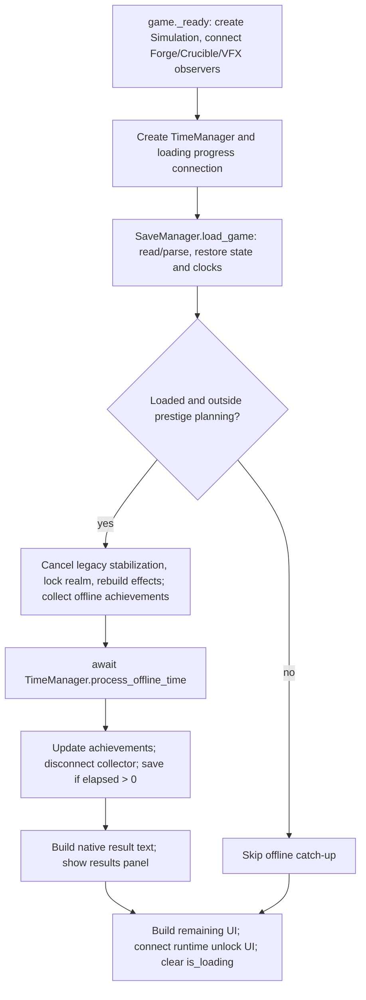

# Exact kernel: TimeManager/offline integration feasibility

## Executive summary and scope

Base `eb5edae81742013b5eaae014d773d0030c79738f`, branch `feature/cycle-auto-run`. The recovered local checkout initially lagged at `182e562`; its intervening Crucible commit was inspected and fast-forwarded on the same branch before edits. The tracked tree was clean. Initial unrelated untracked files are preserved. All implementation is under `tests/`; production TimeManager, Simulation, kernel packet, gameplay formulas and save format are unchanged.

This study distinguishes (1) the real production call graph, (2) an actual native save/load + TimeManager + headless loading/results-control pipeline, and (3) the full rendered client, which is **not** reproduced. Kernel eligibility is not equivalent to production readiness. Existing logger/observer guards remain unchanged. No callbacks are suppressed to obtain admission.

## Production offline call graph

Inspected `game.gd`, `Game/time_manager.gd`, `Game/save_manager.gd`, `Game/GameplayLog.gd`, Simulation, both automation managers, achievements, generator/cycle/relic definitions, RealmView effects, loading/results controls and previous consumer/cycle/equipment/crafting reports.



Within process_offline_time: read current timestamp minus saved timestamp; clamp negative elapsed to zero; await simulate_offline; clear current duration; derive recovery time from final penalty/max; update timestamp; detach state.simulation_statistics; return initial elapsed. No offline-time cap exists in this path. There is no separate focus/resume catch-up entry in game.gd: the audited path is loading an existing save. Application termination can interrupt an await; no transactional cancellation/recovery API is supplied.

simulate_offline resets scheduling diagnostics, returns immediately for nonpositive input, resets its owned ResourceStatistics, calls Simulation.prepare_offline (invalidate both automation indexes), marks active, computes limits/count, binds statistics and emits initial progress. Each iteration increments offline/prestige/current-duration **before** stabilization and dormancy, then dispatches scaled game delta, increments progress/step counters and subtracts remaining real time. A 12 ms work budget controls yields; nonpositive budget uses the reference 100-step schedule. Final progress is emitted and a final frame awaited before clearing active. No gameplay formula depends on yield timing. This is a work target, not a hard latency bound for an expensive tick/callback. Whole loading progress also includes game.gd stage values (55% before catch-up, then offline 0→100%, then 65% resource preparation); only the offline subprogress is claimed monotonic here.

The game performs achievements updates before and after the await, with an offline collector around it. For positive elapsed it saves before building results; zero/future-timestamp cases skip those writes/presentation. A focused zero-path test verifies this wrapper behavior separately. Resource results currently enumerate Heat, Matter, Ash and CF; Essence/Nexum totals remain in statistics but are not added to that native formatting list. Inventory rewards are inventory changes, not invented resource totals. UI notifications already connected before catch-up remain live. Generator-unlock UI is connected only after offline processing and initial UI construction. `_process` returns while is_loading; this does not disable every child node, signal callback, deferred effect or tween.

## Clock ownership and timing semantics

| Clock/state | Owner | Native offline semantics |
|---|---|---|
| Saved wall timestamp | SaveManager / TimeManager | Save writes current floating timestamp; load converts it to int. Subsecond precision is lost on load. get_offline_seconds samples current wall time once and clamps negative elapsed; no upper cap |
| Final wall timestamp | TimeManager | Sampled after catch-up/recovery setup, independently of the initial sample; simulation wall runtime is not added to the original requested catch-up |
| session_time / active_time | TimeManager.update | Advance in normal gameplay, not simulate_offline |
| offline_time / prestige_time | TimeManager | Add each real step before gameplay dispatch; prestige also advances during normal play |
| game_time | TimeManager | Add scaled delta after Simulation.update; do not replace repeated additions with a product |
| current_offline_duration | TimeManager | Starts at zero, drives offline dormancy, resets after process_offline_time |
| Cycle progress / automation cooldowns | Native Simulation/managers | Use dispatched game delta and original registration/order; critical startup snapshots and native RNG remain unchanged |
| Dormancy | TimeManager + GameState | Real-duration delay/ramp written before each tick; live dynamic modifier/input/controller evaluation reads it |
| Recovery | TimeManager.update | Real delta reduces penalty using current penalty and remaining recovery; normal game updates follow; no recovery ticking inside simulate_offline |
| Stabilization | TimeManager | Real-time countdown; completion rebuilds realm effects. Normal saved-game loading cancels this legacy countdown before offline simulation |
| Frame work/progress diagnostics | TimeManager/engine | Wall microseconds, process_frame waits; naturally differ for faster execution, not deterministic gameplay state |
| GameplayLog timestamps | GameplayLog / system Time | Actual wall date/unix time, not simulated game time; file rotation/insertion remains native |

Native offline real-step limit is min(0.1, 0.1/time_scale) for positive scales. Game delta is real step × scale. Zero/negative scales advance real clocks/dormancy without dispatching gameplay. Scales below one produce game deltas below 0.1; the fixed kernel must fall back. TimeManager's offline dispatcher calls Simulation.update directly; it does not call advance(), whose normal-play loop independently subdivides game time. The last step can be partial, and floating remaining-time subtraction can produce an extra very small step. Actual processed steps, not simply ceil(seconds/0.1), are reported. The native final displayed tick is normalized to simulation_total_ticks.

No clock is reassigned to the kernel. The harness controls only external timestamp observations, uses native saved timestamp conversion, and compares actual effective elapsed. Requested durations and loaded/effective durations are distinct for fractional timestamps. Exact equality is used; there is no elapsed-time or numeric tolerance.

## Observer/callback audit

| Category | Actual paths | Integration consequence |
|---|---|---|
| Required gameplay mutation | Native consumption/output, automatic upgrades, both buyers, cycle startup/completion, generation, inventory insertion | Execute in original order through existing methods; no observer suppression or bulk rewards |
| Statistics | Resource accounting, history/offline bookkeeping, TimeManager-owned statistics | Keep original references and writes; attach/detach at native positions |
| Achievements | Save restoration and pre/post-offline AchievementManager.update; offline IDs collector | Preserve collection order and final serialized state; no invented per-tick achievement pass |
| Presentation | Forge standard/critical VFX, level-reduction effect creation, Forge/Crucible toasts | Connected before catch-up; current packet rejects these external Simulation listeners |
| Loading | TimeManager progress to LoadingScreen.set_simulation_tick | Actual control methods exercised headlessly; progress remains coordinator-owned |
| Results/deferred presentation | Results panel text; pending achievements after closing results; effects/tweens/process_frame | Only loading/results controls and result text are exercised here. Full scene/VFX/toasts/audio/render/deferred lifetime are excluded |
| External/unreviewed | Arbitrary mutation callbacks, custom logger/clock/scripts | Preserve native fallback; release packets before every frame yield |

GameplayLog performs per-event dictionary creation, real wall stamps, memory capping at 2,000, file open/seek/write/close and rotation at 2 MiB. Packet.build currently requires the exact isolated TickLog script with no clock. Thus ordinary production GameState logging alone prevents admission. Independently, even a no-op external Simulation observer triggers `external_observer`; source shows production's real observers are connected. A nonempty relic inventory itself is not a blocker. Presentation callbacks are not assumed to be harmless merely from their names: RealmView delegates to controllers and creates nodes/effects; the nested scene behavior and deferred work need a separate reviewed contract.

## Experimental dispatch and invalidation

`offline_kernel_time_manager.gd` subclasses TimeManager, retaining native simulate_offline and process_offline_time in full. It replaces only `_advance_offline_step`: supported 0.1 game-second steps use the existing packet, otherwise native dispatch runs. game_time advances at the original position and association. The packet is private to an uninterrupted frame slice; it is discarded by the first progress listener before the native await. Rejected capability decisions are also reconsidered after the frame, allowing observer removal/reentry. Partial deltas use native dispatch and release configuration. Native automatic-upgrade and purchase invalidations retain existing behavior. No inventory/effect definitions are copied and no resource-balance signature is computed each tick.

TimeManager's prelude changes dormancy between retained packet steps. This is an explicit experimental expansion of the earlier core-only lifetime: the native dormancy modifier is dynamic, and the controller/input paths reread it. Native whole-state comparison is required through ramp and recovery. Stabilization/planning are explicit native boundaries because stabilization can rebuild static realm coefficients. Unknown callbacks remain unsupported. The on_tick hook is owned read-only validation instrumentation, not a supported arbitrary mutation interface.

`offline_native_time_manager.gd` is the throughput control: it inherits production dispatch, loop, yields and finalization unchanged and overrides only the external timestamp source. Instrumented/per-tick differential controls use the same adapter in native mode so an owned read-only post-dispatch trace can be collected; these rows are excluded from throughput medians.

A rebuild-per-tick diagnostic measures the cost of naive run(1)-style integration. A separate idle-gate diagnostic, only on no-automation early gameplay, marks inactive/non-auto cycle entries as non-native within that slice. It is not a production optimization or eligibility exception: no external start is possible before the next released frame boundary, and complete native parity is required. It measures the plausible idle-flag regression from the previous report without changing the public kernel. The archived 182e562 packet supplies an earlier-kernel comparison on supported early states.

The isolated microprofile measures full packet build/release, equipment contract, native cycle/crafting contracts and 1,000 event_due checks. Component calls are separate observations, not additive partitions of a single build. Retained engine static-memory deltas are estimates, not exact heap/peak allocation; no exact dictionary-allocation counter is available. Graph reflection/fingerprint comparison is outside timing. The exploratory pipeline deliberately includes a saved-file verification reread in finalization and comparison-data serialization alongside result generation; those two phase timings are conservative harness costs, not pure production-only costs.

## Fixtures and provenance

Existing fixture files are unchanged. Early/mid/Forge use the recorded core progression; consumer uses the reached 50,000-tick economy; reached_multiple and earned_feedback retain the existing earned equipment/Essence continuations. Earned Crucible first/near completion uses the previous native earned continuation. No disabled buyer, cycle, feedback or equipment is used to improve admission. Fixtures are round-tripped through **native SaveManager.save_game/load_game** in a private test user-data directory before the measured catch-up. This tests actual save restoration, including nonserialized runtime initialization; it is not a direct clone of every transient pre-save flag.

Existing nexum_relics, automation, auto_standard and late_mixed are explicitly controlled diagnostics with their original grants/technology/source configuration. Auto-standard uses a 300-second interval to contain three real crafts, not just the first minute of progress. New diagnostic_multi_buyers enables native MA/Mite buyer technologies on the existing automation diagnostic; diagnostic_high_ash grants one million Ash on the unchanged consumer save. These are not described as earned progression. Original benchmark saves are preserved.

## Headless pipeline methodology and exclusions

Each paired run constructs a deterministic source fixture (excluded setup), writes a native save, then times fresh state construction/native save restoration, preparation/rebuild, native elapsed calculation, process_offline_time, post-offline achievements, native final save, result text and the actual results control. Loading progress calls the actual LoadingScreen control. Result formatting functions are extracted verbatim from the current tail of game.gd and compiled under tests; the unrelated main-script/editor issue is neither loaded nor repaired. No alternative result formula is written.

The pipeline total excludes the fixture-source creation/write, graph/equality comparison and full client scene startup. It includes the verification reread and result-data assembly noted above; it is not a claim of exact production-only CPU cost. It includes real native save/load file IO in a disposable user-data directory, warmed by fixture creation; it is not a disk-cold startup measurement. An explicit extra elapsed-clock probe is also included before process_offline_time under the fixed clock. It excludes RealmView reconstruction, GPU rendering, real VFX/toast/audio observers, viewport/VSync timing and actual full-client save metadata history. It must not be presented as measured production loading speed. Native GameplayLog runs preserve filesystem work and event data; only its inherently external wall stamps are removed in validation fingerprints.

Real-time frame-budget schedules can have different progress-event/yield counts while finishing at the same total. Legacy 100-step cases provide common deterministic tick boundaries. Per-tick traces include numerical/discrete/configuration views, both RNG streams and coordinator clocks/statistics. Endpoint validation includes the existing strict identity-aware graph oracle where its isolated contract applies, an additional read-only graph traversal for native log contexts, complete saved state, result text/data, achievements and event histories. The added traversal is not a checkpoint or restoration mechanism. It follows script variables, object/container aliases and weak back-references; native RNG seed/state are explicit. Immutable definition/native resource metadata and actual external callback/render internals are not claimed as mutable gameplay support.

Durations are 1 min, 10 min, 1 h, 6 h and 24 h using actual native limits and steps. There is no cap to substitute for these durations. Warmups/repeats and timing ranges are retained in raw rows. Long-duration sampling is deliberately smaller than short cases to bound total test time; report the actual sample counts and uncertainty. Existing adaptive results are a core/reference comparison only: its independent coordinator and known dormancy/tail differences do not constitute native end-to-end equivalence. It is not silently substituted for TimeManager.

## Architecture alternatives and future production changes

| Boundary | Assessment |
|---|---|
| Replace TimeManager.simulate_offline | Duplicates clocks, frame policy, statistics and finalization; avoid |
| Call public Kernel.run(1) for every dispatch | Safe external boundary but reconstructs all structure each tick; measure as negative diagnostic |
| Call Kernel.run(many ticks) from game.gd | Bypasses per-step native prelude/dormancy and partial tail; unsafe as-is |
| TimeManager tick-dispatch adapter with frame-slice ownership | Smallest experimentally reviewable surface; coordinator remains authoritative |
| Replace Simulation.update globally | Unnecessary normal-gameplay exposure and callback scope; avoid in this milestone |

A future opt-in production implementation would need: an explicit dispatcher strategy or hook at `_advance_offline_step`; begin/release lifecycle tied to native progress/yield boundaries; reviewed passthrough contracts for original GameplayLog and named presentation observers; native partial/fallback behavior; a disable toggle; native default/fallback retained; renderer/client tests and Windows validation. No save-format or gameplay formula change is required by this design. This is a proposal, not delivered production support.

Maintenance remains tied to audited definitions/modifier operations and native cycle callbacks. New resources fitting current IO tapes are cheap structurally; new dynamic formulas, recipe effects, observers or mutable static coefficients require review/invalidation tests. Native generation/critical RNG must continue to own outcomes. C#/Rust is a later profile-driven option; changing language cannot solve missing callback/clock contracts and is not justified before measuring the real admitted workload.

## Remaining risks and recommendation

Production logger/presentation guards, external mutations, unreviewed runtimes/effects, planning and legacy stabilization, full rendered/deferred behavior and platform coverage remain explicit boundaries. Frame-slice rebuilding is intentionally conservative and can remove isolated-kernel gains. File IO and UI/startup may dominate short absences. Faster native-core throughput alone does not establish a production-loading benefit.

The measured tables and explicit go/no-go assessment follow. No production integration is delivered or established by this study.

## Measured results and validation

Environment: **AMD EPYC 9V74 80-Core Processor**, Linux, Godot **4.6.1.stable.official.14d19694e**. Only one Godot timing/profiling process from this study ran at a time; concurrent correctness runs were not used for performance. Main/variant pairs were native-first. Confirmation uses six measured repeats after a warmup, alternates order and clears/hides result controls between cases. Those are multiple methodological differences, so confirmation is not an isolated explanation of the main variance.

The timings describe the bounded **headless experimental pipeline**, including the explicitly documented verification reread and result-data assembly. They exclude full scene startup/rendering and real presentation observers. Source preparation/write is excluded. Every compared path uses identical native saved state and effective elapsed time; no exact replay decides runtime admission.

### Main short pipeline timings

Milliseconds: median [min–max], three measured samples after one warmup. Auto-standard uses 300 seconds and crosses three native crafts.

| Fixture / requested seconds | Scope | Native pipeline ms | Experimental pipeline ms | Speedup | Kernel coverage | Median builds |
|---|---|---:|---:|---:|---:|---:|
| early / 60 | isolated | 113.745 [113.312–136.204] | 71.619 [43.738–76.451] | 1.59× | 99.833% | 5 |
| consumer_50000 / 60 | isolated | 159.254 [97.547–171.510] | 130.972 [70.192–141.971] | 1.22× | 99.833% | 9 |
| mid / 60 | isolated | 119.636 [65.275–126.779] | 94.004 [51.789–130.914] | 1.27× | 99.500% | 8 |
| forge_competing / 60 | isolated | 371.980 [360.568–379.057] | 364.010 [336.214–402.101] | 1.02× | 99.833% | 26 |
| reached_multiple / 60 | isolated | 261.038 [258.431–333.258] | 216.020 [194.639–234.461] | 1.21× | 99.833% | 15 |
| earned_craft_first_craft / 60 | isolated | 260.072 [206.371–267.070] | 235.091 [216.805–240.157] | 1.11× | 99.833% | 17 |
| earned_craft_near_completion / 60 | isolated | 239.433 [237.299–367.655] | 289.456 [199.805–412.930] | 0.83× | 99.833% | 19 |
| auto_standard / 300 | isolated | 1396.324 [1371.037–1398.185] | 1076.915 [1039.594–1204.394] | 1.30× | 99.933% | 80 |
| earned_feedback / 60 | isolated | 325.931 [310.613–332.695] | 246.901 [214.257–327.033] | 1.32× | 99.833% | 18 |
| nexum_relics / 60 | isolated | 331.740 [310.123–451.593] | 308.602 [301.575–346.931] | 1.07× | 99.667% | 32 |
| automation / 60 | isolated | 322.366 [314.763–368.712] | 261.092 [247.412–339.997] | 1.23× | 99.667% | 29 |
| late_mixed / 60 | isolated | 309.339 [292.809–462.384] | 240.978 [233.099–358.459] | 1.28× | 99.667% | 29 |
| diagnostic_multi_buyers / 60 | isolated | 394.807 [324.611–406.725] | 359.470 [326.716–803.604] | 1.10× | 99.667% | 40 |
| diagnostic_high_ash / 60 | isolated | 178.843 [142.493–259.860] | 115.520 [98.498–136.036] | 1.55× | 99.833% | 8 |
| earned_craft_first_craft / 60 | production_logger | 241.087 [235.054–249.388] | 246.305 [206.886–294.095] | 0.98× | 0.000% | 18 |
| earned_craft_first_craft / 60 | observer | 247.911 [225.365–280.564] | 266.125 [236.300–269.007] | 0.93× | 0.000% | 19 |

### Balanced confirmation

| Fixture / scope | Native pipeline ms | Experimental pipeline ms | Speedup | Coverage |
|---|---:|---:|---:|---:|
| early / isolated | 131.461 [108.726–173.580] | 77.129 [64.177–108.612] | 1.70× | 99.833% |
| forge_competing / isolated | 368.999 [286.616–449.077] | 339.019 [310.021–369.331] | 1.09× | 99.833% |
| earned_craft_near_completion / isolated | 221.867 [145.087–250.504] | 197.453 [110.875–274.929] | 1.12× | 99.833% |
| auto_standard / isolated | 1485.194 [1319.888–1584.768] | 1055.681 [981.757–1426.806] | 1.41× | 99.933% |
| earned_craft_first_craft / production_logger | 241.013 [143.666–324.057] | 253.065 [174.664–387.481] | 0.95× | 0.000% |
| earned_craft_first_craft / observer | 239.329 [169.157–260.238] | 249.113 [147.333–329.745] | 0.96× | 0.000% |

The main earned near-completion median regressed to **0.83× native**, while confirmation measured **1.12×**. Both are retained; neither a universally faster completion path nor a causal fix is established. Forge was only 1.02× in the main pipeline (1.09× confirmation). Production-logger and observer fixtures have **zero kernel coverage** and are slower in both sets; this is fallback overhead, not acceleration. Confirmation logger/observer speedups are approximately 0.95×/0.96×.

### Offline duration scaling

The scale fixture is the unchanged early progression state at time_scale 1. Long durations use one warmup and **two** measured pairs; shorter durations use three. These are not late-game scaling claims. The pipeline ranges include substantial shared-host variation. All long intervals actually execute native 0.1-second semantics, not a cap or analytical replacement.

| Requested/effective real seconds | Actual steps | Measured n | Native pipeline s [range] | Experimental pipeline s [range] | Speedup | Kernel coverage | Fallbacks / median builds |
|---|---:|---:|---:|---:|---:|---:|---:|
| 60 / 60 | 600 | 3 | 0.114 [0.113–0.136] | 0.072 [0.044–0.076] | 1.59× | 99.83333% | 1 / 5 |
| 600 / 600 | 6,000 | 3 | 1.328 [1.277–1.415] | 0.817 [0.704–1.304] | 1.62× | 99.98333% | 1 / 58 |
| 3600 / 3600 | 36,001 | 3 | 7.534 [7.003–8.506] | 4.504 [4.140–5.637] | 1.67× | 99.99722% | 1 / 333 |
| 21600 / 21600 | 216,001 | 2 | 44.820 [43.556–46.085] | 32.405 [31.870–32.939] | 1.38× | 99.99954% | 1 / 2346.5 |
| 86400 / 86400 | 864,000 | 2 | 205.098 [177.330–232.865] | 127.481 [125.952–129.010] | 1.61× | 99.99988% | 1 / 9279.5 |

One hour processes **36,001** steps and six hours **216,001**, reflecting native floating remaining-time behavior; 24 hours processes **864,000**. Partial final deltas use native execution. Raw rows retain actual accumulated real/game clocks. Faster work has different real-budget yield counts, which are scheduling diagnostics, not gameplay divergence.

### Pipeline phase breakdown

Medians in milliseconds, main kernel path. Coordinator runtime already includes frame waits, dispatch, bookkeeping and loading callbacks; do not add frame_wait again. Save includes verification reread; result includes comparison-data assembly. Submicrosecond elapsed-clock samples often quantize to zero and do not mean free computation.

| Fixture / scope | Restore | Prepare | Coordinator | Frame wait (nested) | Achievement | Save/read | Results/data |
|---|---:|---:|---:|---:|---:|---:|---:|
| early / isolated | 4.692 | 0.370 | 64.233 | 9.578 | 0.241 | 1.436 | 0.254 |
| consumer_50000 / isolated | 3.899 | 0.687 | 122.685 | 15.868 | 0.317 | 1.353 | 0.161 |
| mid / isolated | 6.057 | 0.304 | 84.545 | 11.382 | 0.350 | 1.371 | 0.216 |
| forge_competing / isolated | 4.772 | 0.934 | 356.212 | 38.284 | 0.294 | 2.185 | 0.160 |
| earned_craft_near_completion / isolated | 8.020 | 2.009 | 278.013 | 46.064 | 0.298 | 1.600 | 0.214 |
| auto_standard / isolated | 4.806 | 0.774 | 1067.768 | 92.023 | 0.244 | 1.868 | 0.252 |
| earned_craft_first_craft / production_logger | 4.022 | 0.321 | 239.573 | 26.326 | 0.312 | 1.801 | 0.183 |
| earned_craft_first_craft / observer | 5.554 | 0.582 | 257.242 | 23.067 | 0.389 | 1.422 | 0.160 |

### Retention versus repeated admission

Six measured samples after a warmup. Diagnostic results are not runtime optimizations. The idle-gate variant is **not faster** in this measurement. A per-tick rebuild is decisively expensive even though every native parity assertion passes.

| Diagnostic | Native pipeline ms | Kernel pipeline ms | Speedup | Median builds |
|---|---:|---:|---:|---:|
| isolated | 119.428 [87.402–130.482] | 71.566 [67.721–76.629] | 1.67× | 5 |
| previous_packet | 122.120 [101.619–175.959] | 73.371 [56.891–94.276] | 1.66× | 5 |
| per_tick_build | 119.878 [98.605–139.835] | 435.007 [354.255–641.233] | 0.28× | 599 |
| diagnostic_idle_gate | 117.227 [99.183–218.620] | 80.243 [61.460–90.959] | 1.46× | 5.5 |

### Packet microprofile

Ten observations after one warmup. Contract calls are standalone microprobes, not disjoint partitions of construction. The retained delta covers the empty packet plus its constructed graph in this final probe. Rejected builds have no meaningful successful packet-size interpretation.

| Fixture | Admitted | Build µs | Equipment µs | Cycle/crafting contract µs | event_due µs/check | Release µs | Retained estimate bytes |
|---|---|---:|---:|---:|---:|---:|---:|
| early | True | 1112.5 | 7.0 | 35.0 | 4.249 | 61.0 | 23604 |
| mid | True | 702.5 | 7.0 | 26.0 | 6.670 | 58.0 | 23676 |
| reached_multiple | True | 825.0 | 7.0 | 25.5 | 3.956 | 32.5 | 27312 |
| earned_craft_first_craft | True | 1000.5 | 7.5 | 26.0 | 3.205 | 29.0 | 27288 |
| auto_standard | True | 559.0 | 5.0 | 26.0 | 3.147 | 22.5 | 31020 |
| late_mixed | True | 692.0 | 7.0 | 24.5 | 1.595 | 21.0 | 39128 |
| reject_logger | False | 19.0 | 13.5 | 50.5 | 0.125 | 1.0 | 2456 |
| reject_observer | False | 441.5 | 14.0 | 48.0 | 0.109 | 2.0 | 2456 |

Equipment/crafting checks alone are small relative to full packet construction. Current equipment admission does not traverse/copy passive inventory. Full build traverses upgrade/requirement/generator/modifier structure and constructs compact IO/rate objects; this is the larger amortization target. The logger rejection occurs early; observer rejection occurs after more structural validation. Negative decisions are cached only until the next frame, when callbacks may have changed. No speculative structural cache was added to GameState.

### Memory and native callback probes

Memory values are **retained static-engine deltas**, not exact heap, peak RSS or allocation counts. Simulation deltas also include the study event journal and retained progress history (production LoadingScreen does not store that history). Therefore lower kernel deltas must not be advertised as production memory savings.

| Scale seconds | Native retained delta median B | Kernel retained delta median B |
|---|---:|---:|
| 60 | -2.95276e+06 | -1.95492e+06 |
| 600 | -3.83582e+06 | -2.04302e+06 |
| 3600 | -3.75643e+06 | -1.99358e+06 |
| 21600 | -3.28949e+06 | -1.65747e+06 |
| 86400 | -1.27728e+06 | -425680 |

The actual loading-control setter microprobe takes median **3779.5 µs per 1,000 calls** (range 3158–5385, ten observations after a warmup). This excludes rendering/layout deferred to later frames and full client presentation.

The separate intrusive native Simulation/Crucible profiler matches uninstrumented gameplay views and coordinator clocks in five scenarios. Native cycle/completion/generation/recipe/item timers are nested and include instrumentation overhead; do not add child times to parent totals or treat them as throughput medians.

| Fixture | Craft completions | Native completion µs | Generation calls / µs | Random reward µs | Recipe µs |
|---|---:|---:|---:|---:|---:|
| early | 0 | 0 | 0 / 0 | 0 | 0 |
| consumer_50000 | 0 | 0 | 0 / 0 | 0 | 0 |
| earned_craft_near_completion | 1 | 614 | 1 / 304 | 562 | 0 |
| auto_standard | 3 | 2965 | 3 / 2537 | 2696 | 107 |
| late_mixed | 0 | 0 | 0 / 0 | 0 | 0 |

Native profile root generator/automatic-upgrade/environment/automation totals and call counts are retained in `offline_integration_profiles.json`. Generation remains native and infrequent. No completion, RNG, notification or recipe cost is subtracted from public pipeline timing.

## Standalone kernel reference (not an offline-loading benchmark)

The complete existing 53-scenario public-kernel benchmark was rerun on this host. All previous/current exact-kernel endpoints match native. This table is separate from the coordinator pipeline above. The previous packet is the archived 182e562 implementation; published timings from other hosts are not treated as a matched baseline.

| Fixture / ticks | Native ms | Previous ms | Current ms | Current native speedup | Current runtime Δ previous |
|---|---:|---:|---:|---:|---:|
| early / 2,000 | 399.60 | 194.04 | 214.46 | 1.86× | +10.52% |
| early / 36,000 | 6771.14 | 3403.64 | 3145.68 | 2.15× | -7.58% |
| consumer_50000 / 2,000 | 431.78 | 286.72 | 285.14 | 1.51× | -0.55% |
| consumer_50000 / 10,000 | 2328.68 | 1619.51 | 1396.50 | 1.67× | -13.77% |
| mid / 2,000 | 342.20 | 244.10 | 229.58 | 1.49× | -5.95% |
| mid / 10,000 | 3400.73 | 1652.23 | 1577.52 | 2.16× | -4.52% |
| forge_competing / 2,000 | 1180.50 | 893.04 | 899.63 | 1.31× | +0.74% |
| forge_competing / 10,000 | 5530.40 | 4508.74 | 4617.42 | 1.20× | +2.41% |
| earned_essence / 10,000 | 4454.10 | 2945.18 | 3153.84 | 1.41× | +7.08% |
| earned_feedback / 10,000 | 4307.77 | 3175.96 | 3503.65 | 1.23× | +10.32% |

Standalone confirmation (six measured samples) retains further regressions:

| Fixture / ticks | Current native speedup | Current runtime Δ previous |
|---|---:|---:|
| early / 2,000 | 2.05× | +2.25% |
| early / 36,000 | 1.82× | -10.49% |
| forge_competing / 10,000 | 1.32× | +9.07% |
| earned_essence / 10,000 | 1.50× | -0.34% |

The earlier published +6% long-early regression is not reproduced here: the matched long-early trial improves, while short-early and Forge confirmation regress. Source and raw ranges are retained. No causal fix or universally preserved throughput is claimed. This reinforces the no-go recommendation pending real client profiling.

## Exact parity and regression record

The complete registered suite passed **98/98**, including existing transaction rollback, exact resource/consumer/controller/automation/cycle/equipment/Essence/Nexum/crafting and RNG groups. The new dedicated study passed **30 offline pairs / 19,254 per-dispatch endpoints**, plus critical Greater-relic crafting, joint Forge/Crucible completion and starvation in **three additional pairs / 2,621 endpoints** (combined **21,875 endpoints**). These checks use exact bytes for gameplay, phases, modifiers/caches, inventory/equipment, RNG, statistics, achievements, clocks, saved envelopes and result text/data. No numeric tolerance was introduced. Progress scheduling diagnostics and actual native log wall stamps have the explicit external contract above.

The zero/future-timestamp wrapper was corrected to skip final save and result presentation like game.gd; focused zero/fractional cases verify this separately. Earlier zero-case raw rows establish coordinator/gameplay equivalence, not the corrected skip-write presentation behavior. A wall-clock fractional case also retains native saved timestamp truncation.

Main 78 pairs, balanced confirmation 42 pairs, retention diagnostics 29 pairs and the dedicated boundary pairs all have empty failure arrays. Long consumer dormancy to maximum and 62 real seconds of native recovery match exactly. Frame purchases, stabilization completion, external observer removal/reentry, multiple buyers, high Ash and active crafting remain checked.

The complete existing 53-scenario kernel benchmark and its eight-scenario confirmation were rerun: **424 + 112 = 536 byte-exact previous/current-kernel comparisons**, including warmups, all passing. The existing three-scenario smoke adds 24 comparisons. Original adaptive-reference mismatches remain separately recorded and are not attributed to the exact kernel. Native intrusive callback probes also preserve gameplay/clocks. All completed study/regression/benchmark logs contain no parser warnings or runtime errors.

Focused zero/future/fractional cases pass after the skip-write correction, including the actual native user-directory containment check. There is no production-gameplay or kernel-source change. Windows Godot 4.7.2 remains unverified.

## Go/no-go and next task

**NO-GO for production integration with the current guards.** Ordinary GameState uses GameplayLog, and the real game connects Forge/Crucible presentation listeners before catch-up. These are independent admission blockers. The measured logger/observer paths have zero acceleration and small slowdowns. Headless isolated coverage does not establish production readiness, rendered loading speed or Windows 4.7.2 behavior.

**GO for a narrowly scoped follow-up prototype under tests.** Keep TimeManager as coordinator and preserve its dispatch clock increment. Add a reviewed passthrough contract for the original native logger and explicitly named existing presentation callbacks; preserve every native invocation, timestamp semantics and event order. Then run the actual client/loading flow, including deferred effects, input at frame boundaries, results/achievement queues, file IO and renderer/VSync work. Do not replace missing review with a broad callback whitelist.

The smallest later production hook is an optional gameplay-step dispatcher at `_advance_offline_step`, with the original `game_time += game_seconds` remaining in TimeManager after either backend. Release the execution session before each emit/yield/load/exit, use native partial steps and retain an immediate disable/native default. Promote reviewed runtime helpers out of tests only after this scope is proven; current runtime admission references test-only TickLog/journal classes and must not become a production dependency.

The approximately 6% earlier standalone early-game regression was not causally resolved. This study finds per-tick structural reconstruction costly, equipment checks small, and no measured benefit from its idle diagnostic. Prioritize admission/lifecycle correctness and actual client profiling over further speculative GDScript caching. C#/Rust should be considered only after a real admitted workload profile identifies remaining numerical/call overhead; it cannot solve observer/clock ownership.

No production change, approximate batching, speculative checkpoint, resource/balance/RNG/save change or additional runtime dependency is delivered. Full client rendering and Windows validation remain outstanding.


## Reproduction and artifact guide

Use the strict driver on Linux. It provides a disposable native user-data directory; the GDScript entry points now verify that actual user:// resolution stays beneath that directory and refuse unscoped/direct IO or unvalidated platforms. This prevents accidentally replacing a player save while measuring native SaveManager operations. There is no Windows validation or portable Windows user-directory contract in this study.

```sh
python tests/experimental/run_offline_integration_study.py --godot /path/to/godot --mode tests
python tests/experimental/run_offline_integration_study.py --godot /path/to/godot --mode boundaries
python tests/experimental/run_offline_integration_study.py --godot /path/to/godot --mode zero
python tests/experimental/run_offline_integration_study.py --godot /path/to/godot --mode bench
python tests/experimental/run_offline_integration_study.py --godot /path/to/godot --mode overhead_variants
python tests/experimental/run_offline_integration_study.py --godot /path/to/godot --mode confirm
python tests/experimental/run_offline_integration_study.py --godot /path/to/godot --mode micro
python tests/experimental/run_offline_integration_study.py --godot /path/to/godot --mode profiles
python tests/experimental/summarize_offline_integration.py
```

`offline_integration_bench.json` retains the main complete pipeline/scaling rows; `confirm.json` retains the separate balanced confirmation; `summary.json` preserves medians/ranges/sample counts without deleting samples. Dedicated tests, critical/joint boundaries, zero paths, overhead variants, microprobes and intrusive profiles have separate JSON/log evidence. Existing public-kernel benchmark reruns are copied to the `offline_integration_existing_*` files; historical measurements remain unchanged. The complete suite log is `offline_integration_regression.log`.

Runtime prototype: `offline_kernel_time_manager.gd`; native throughput clock control: `offline_native_time_manager.gd`; read-only validation: `offline_state_fingerprint.gd`; fixture reuse/explicit diagnostics: `offline_integration_fixtures.gd`; safety boundary: `offline_study_user_scope.gd`. None is loaded by production gameplay. All graph/equality assertions are in `offline_integration_study.gd`; the separate microprofile and native callback probes do not alter acceptance rules.

## Changed-file manifest

- `tests/experimental/EXACT_FLOW_RELIC_CRAFTING.md`
- `tests/experimental/EXACT_FLOW_TIMEMANAGER_INTEGRATION.md`
- `tests/experimental/offline_integration_bench.json`
- `tests/experimental/offline_integration_bench.log`
- `tests/experimental/offline_integration_boundaries.json`
- `tests/experimental/offline_integration_boundaries.log`
- `tests/experimental/offline_integration_confirm.json`
- `tests/experimental/offline_integration_confirm.log`
- `tests/experimental/offline_integration_environment.json`
- `tests/experimental/offline_integration_equipment_validation.json`
- `tests/experimental/offline_integration_essence_validation.json`
- `tests/experimental/offline_integration_existing_confirmation_kernel.json`
- `tests/experimental/offline_integration_existing_confirmation_kernel.log`
- `tests/experimental/offline_integration_existing_full_kernel.json`
- `tests/experimental/offline_integration_existing_full_kernel.log`
- `tests/experimental/offline_integration_existing_kernel.json`
- `tests/experimental/offline_integration_existing_kernel.log`
- `tests/experimental/offline_integration_fixtures.gd`
- `tests/experimental/offline_integration_overhead.gd`
- `tests/experimental/offline_integration_overhead.json`
- `tests/experimental/offline_integration_overhead.log`
- `tests/experimental/offline_integration_overhead_variants.json`
- `tests/experimental/offline_integration_overhead_variants.log`
- `tests/experimental/offline_integration_profiles.gd`
- `tests/experimental/offline_integration_profiles.json`
- `tests/experimental/offline_integration_profiles.log`
- `tests/experimental/offline_integration_regression.log`
- `tests/experimental/offline_integration_relic_regression_validation.json`
- `tests/experimental/offline_integration_smoke.json`
- `tests/experimental/offline_integration_smoke.log`
- `tests/experimental/offline_integration_study.gd`
- `tests/experimental/offline_integration_summary.json`
- `tests/experimental/offline_integration_tests.json`
- `tests/experimental/offline_integration_tests.log`
- `tests/experimental/offline_integration_zero.json`
- `tests/experimental/offline_integration_zero.log`
- `tests/experimental/offline_kernel_time_manager.gd`
- `tests/experimental/offline_native_time_manager.gd`
- `tests/experimental/offline_state_fingerprint.gd`
- `tests/experimental/offline_study_user_scope.gd`
- `tests/experimental/run_offline_integration_study.py`
- `tests/experimental/summarize_offline_integration.py`
